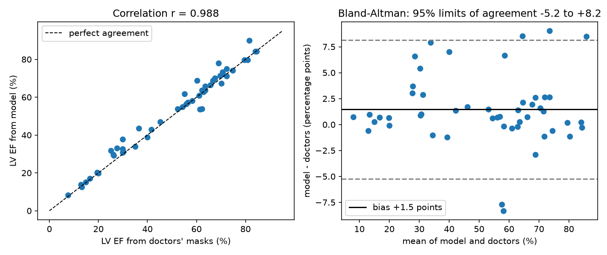
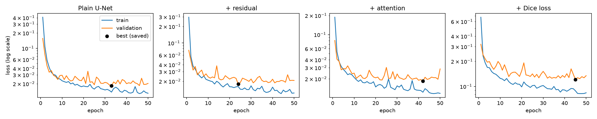

# Cardiac MRI Segmentation

A tested, reproducible PyTorch pipeline that outlines the heart in cardiac MRI (right ventricle, myocardium and left ventricle) and turns the outlines into the measurements cardiologists use: ventricular volumes, ejection fraction and myocardial mass. Trained and evaluated on the public [ACDC dataset](https://www.creatis.insa-lyon.fr/Challenge/acdc/) (150 patients).


## Results at a glance

On the 50 held-out ACDC test patients, evaluated once after all choices were made on validation:

- **Dice:** 0.943 left ventricle, 0.909 right ventricle, 0.903 myocardium.
- **Ejection fraction:** left-ventricular EF within 2.5 percentage points, on average, of the EF computed from the experts' manual segmentations (correlation r = 0.988).
- **Benchmark:** 0.002 to 0.016 Dice below the winner of the 2017 ACDC challenge on the same 50 patients, for every structure and phase, using a single 2D model trained on a laptop ([details and caveats](#comparison-with-the-2017-challenge-winner)).
- **Engineering:** 48 tests and GitHub Actions CI, a leakage-free patient-level split, a controlled ablation study, and evaluation in real units (mm, mL, g) on each patient's original scan grid.



*Left: left-ventricular EF from the model vs from the experts' masks, one dot per test patient. Right: Bland-Altman plot of the differences. On average the model reads 1.5 points high, and 95% of differences are expected to fall between -5.2 and +8.2 points.*

**Contents:** [What it does](#what-it-does) · [Results](#results-test-set) · [Ablation](#ablation-study-validation-set) · [Design decisions](#design-decisions) · [Testing](#testing) · [Reproduce](#reproduce) · [Limitations](#limitations) · [Roadmap](#roadmap-v2) · [Data, citation and licence](#data-citation-and-licence)

Full experiment log: [EXPERIMENTS.md](EXPERIMENTS.md). Per-patient results: [results/](results/).

## What it does

```
ACDC scan (NIfTI) + Info.cfg
  -> load the end-diastole (ED) and end-systole (ES) frames, voxel spacing from the file header
  -> resample in-plane to 1.25 mm -> z-score -> centre crop/pad to 224 x 224
  |
  |-- training:    2D slices -> paired augmentation -> U-Net -> cross-entropy + Dice loss -> Adam
  |                keep the epoch with the lowest validation loss
  |
  '-- evaluation:  every slice of the 3D scan -> U-Net -> argmax
                   -> keep the largest 3D connected component per structure
                   -> undo the crop and resampling (back to the original grid)
                   -> Dice, HD95 (mm), volumes (mL), ejection fraction (%), myocardial mass (g)
```

A few terms used below:

- **ED / ES:** end-diastole (heart fullest) and end-systole (heart emptiest), the two time points ACDC annotates.
- **Ejection fraction (EF):** the share of blood pumped out per beat, (EDV - ESV) / EDV, from the ED and ES volumes. A low left-ventricular EF is a key sign of heart failure.
- **Dice:** overlap between the predicted and the reference region, from 0 (none) to 1 (perfect).
- **HD95:** the 95th-percentile distance between the predicted and reference boundaries, in mm. It measures how far the outline strays.

## Results (test set)

Final model: U-Net with residual blocks and attention gates, trained with cross-entropy + Dice loss, with largest-component post-processing. Scored on ACDC patients 101-150 (the official test set, 10 per diagnosis group). All metrics are computed per patient in 3D, in each scan's original resolution.

| | RV | Myocardium | LV |
|---|---|---|---|
| Dice (mean of ED and ES) | 0.909 | 0.903 | 0.943 |
| HD95 mean (mm) | 5.8 | 3.1 | 3.5 |
| HD95 median (mm) | 3.8 | 1.7 | 1.7 |

### Comparison with the 2017 challenge winner

Same 50 test patients. The winner's numbers are from Bernard et al. 2018 (Tables III and IV).

| | This model | Challenge winner (Isensee et al.) |
|---|---|---|
| Dice LV, ED / ES | 0.966 / 0.921 | 0.968 / 0.931 |
| Dice RV, ED / ES | 0.935 / 0.883 | 0.946 / 0.899 |
| Dice myocardium, ED / ES | 0.895 / 0.910 | 0.902 / 0.919 |
| LV EF correlation | 0.988 | 0.991 |

Caveats: these metrics come from this project's own evaluation code, not the challenge organisers' platform. The challenge reported the full Hausdorff distance rather than HD95, so distance metrics are deliberately left out of this comparison. The model is close to the winner, but it does not match or beat it.

### Clinical measurements

Model vs the same measurement computed from the experts' masks (positive bias = model reads higher):

| | Bias | Mean absolute error | Correlation r | 95% limits of agreement |
|---|---|---|---|---|
| LV ejection fraction | +1.5 points | 2.5 points | 0.988 | -5.2 to +8.2 points |
| RV ejection fraction | +1.3 points | 5.2 points | 0.842 | -13.9 to +16.5 points |
| LV end-diastolic volume | -3.3 mL | 4.7 mL | 0.997 | -13.2 to +6.6 mL |
| Myocardial mass | +6.7 g | 8.4 g | 0.989 | -8.7 to +22.0 g |

Myocardial mass = ED myocardium volume x 1.05 g/mL.

What these numbers do and don't show:

- **Clinical cut-off.** 18 of the 50 test patients have an LV EF below 40% by the experts' masks, a common threshold for heart failure with reduced ejection fraction. The model puts 49 of 50 patients on the correct side of it. The exception is patient115 (previous heart attack): 43.5% from the model vs 36.5% from the experts.
- **By diagnosis group,** LV EF mean absolute error ranges from 1.8 points (abnormal right ventricle) to 3.4 points (hypertrophic cardiomyopathy, where the thickened muscle squeezes the cavity to a slit at end-systole). The largest single LV EF error is 9.0 points (patient138, hypertrophic cardiomyopathy: 78.0% vs 69.0%).
- **The right ventricle is the weakest structure, especially at end-systole.** One patient dominates the RV EF error: patient120 (previous heart attack) reads 77.5% vs 46.5%, because the model found only 11.0 mL of RV at end-systole where the experts drew 32.0 mL (ES RV Dice 0.472). Without this patient, the RV EF correlation is 0.883. EF divides by the volumes, so a small RV error at end-systole becomes a large EF error.
- **Post-processing was roughly neutral on the test set** (LV Dice 0.945 raw vs 0.943 post-processed, LV EF error 2.3 vs 2.5 points), and the details show its trade-off. It fixed one stray right-ventricle prediction (patient135), but for patient142 (hypertrophic cardiomyopathy) the model's end-systolic LV came out in separate pieces and the filter deleted a real one: ES LV Dice fell from 0.899 to 0.673. That single patient accounts for the entire drop in mean LV Dice. Raw test numbers are in [EXPERIMENTS.md](EXPERIMENTS.md#raw-vs-post-processed-test-results).

## Ablation study (validation set)

Each row adds one change to the row above. All runs use the same seed, data and 50-epoch schedule. Validation set: 20 patients, 4 from each diagnosis group. Values are means over ED and ES; EF error is the mean absolute error in percentage points.

| Change | Dice RV | Dice Myo | Dice LV | HD95 RV (mm) | HD95 Myo | HD95 LV | LV EF error | RV EF error |
|---|---|---|---|---|---|---|---|---|
| Plain U-Net, cross-entropy | 0.879 | 0.895 | 0.947 | 10.7 | 3.7 | 2.7 | 2.1 | 6.0 |
| + residual blocks | 0.878 | 0.894 | 0.942 | 7.1 | 3.4 | 4.1 | 2.7 | 6.5 |
| + attention gates | 0.877 | 0.899 | 0.945 | 10.2 | 3.1 | 4.0 | 2.8 | 6.4 |
| + Dice loss term | 0.887 | 0.902 | 0.949 | 6.9 | 4.2 | 3.3 | 2.2 | 5.9 |
| + largest-component post-processing | 0.888 | 0.902 | 0.950 | 6.8 | 4.2 | 3.0 | 2.0 | 5.9 |

Findings:

1. **Residual blocks and attention gates gave no measurable improvement.** Dice changed by less than 0.01 between neighbouring rows, which is within run-to-run noise for a single seed. Likely reasons: a U-Net of this depth (about 20 layers) has little vanishing-gradient problem for residual connections to solve, and its skip connections already give gradients a short path. The 224 x 224 crop also removes most of the background clutter that attention gates are meant to filter.
2. **Adding the Dice loss term was the only change with a clear gain,** largest on the right ventricle (about +0.01 Dice). That fits what Dice loss does: cross-entropy is dominated by the background (about 90% of pixels), while Dice weights each structure equally. An extra run (plain U-Net + Dice loss, no residual or attention) also raised RV and myocardium Dice over plain cross-entropy, which points to the loss, not the architecture, as the source of the gain. See [EXPERIMENTS.md](EXPERIMENTS.md#extra-run-plain-u-net-with-dice-loss).
3. **Trade-off:** myocardium HD95 rose from 3.1 to 4.2 mm when the Dice term was added.
4. **Single seed:** differences this small should not be over-interpreted.

The final model keeps residual blocks and attention gates even though they did not measurably help. It was chosen because it had the best validation numbers overall; the simpler plain U-Net + Dice loss is within noise of it.



*Training and validation loss for each ablation run (log scale); the dot marks the saved checkpoint (lowest validation loss). Losses are comparable within a run, not across runs: the last run adds a Dice term, which changes the scale.*

## Design decisions

**Data and environment**
- Python 3.12 with [uv](https://docs.astral.sh/uv/) and a committed lockfile, so the environment is exactly reproducible. CI installs CPU-only PyTorch on Linux.
- Voxel spacing is read from every file header, because it varies between patients. The loader fails loudly if an image and its mask have different shapes.
- Data and model weights are never committed (see [Data, citation and licence](#data-citation-and-licence)).

**Preprocessing**
- Resample in-plane to 1.25 mm so a heart is the same size in pixels in every scan. The slice spacing (about 10 mm) is left alone. Masks use nearest-neighbour interpolation; bilinear interpolation created non-label values such as 0.01.
- Z-score each volume, because MRI intensities have no fixed units.
- Centre crop/pad to 224 x 224 pixels (280 mm). Across all 200 training masks, the farthest heart edge is 134 mm from the image centre (patient046), inside the 140 mm half-width.

**Split**
- Split by patient, never by slice. Slices from one patient are near-duplicates, so a slice-level split would leak.
- Stratified: 4 validation patients from each of the 5 diagnosis groups (dilated cardiomyopathy, hypertrophic cardiomyopathy, previous heart attack, abnormal right ventricle, normal), seed 42, committed as [splits/acdc.json](splits/acdc.json). That leaves 80 patients for training. The 50 official test patients were used exactly once.

**Augmentation**
- One random geometric transform (rotation ±15°, scale 0.9-1.1, shift ±10 px) is drawn once and applied identically to the image and its mask (bilinear vs nearest-neighbour), followed by brightness, contrast and noise changes on the image only. No flips: a mirrored heart puts the right ventricle on the wrong side, which never happens in real scans.
- [Why this has its own test](#testing).

**Model**
- 2D, slice by slice, rather than 3D. Slices are about 10 mm apart while pixels are about 1.5 mm, and patients have between 6 and 21 slices.
- U-Net (channels 32 to 512, five resolution levels): the encoder learns *what* is in the image, the decoder recovers *where*, and skip connections keep boundaries sharp. 7,762,564 parameters plain; 8,201,464 with residual blocks and attention gates.

**Loss and training**
- Cross-entropy + soft Dice (Dice averaged over the three heart structures, background excluded). Cross-entropy is stable; Dice stops the small structures from being drowned out by the background. Tested as its own ablation row.
- Adam, learning rate 1e-3, batch size 8, 50 epochs, seed 0, on an Apple Silicon laptop GPU (PyTorch MPS). The checkpoint with the lowest validation loss is kept.

**Evaluation**
- Dice and HD95 are implemented from scratch in NumPy/SciPy and checked by known-answer tests and a brute-force HD95 comparison over all boundary-point pairs.
- Metrics are computed per patient in 3D, in the original scan grid and in real units. No pixel accuracy: with about 90% background, it is meaningless.
- HD95 is coarse along the slice axis. Many values are exactly 10.0 mm, which is one slice gap (an extra or missing slice at the base or apex of the heart). That is expected, not a bug.

**Post-processing**
- Keep the largest 3D connected component of each structure. On validation this removed stray predictions far from the heart (patient009's RV HD95 went from 93.7/87.1 mm to 11.4/15.7 mm at ED/ES with the first model). It can also delete real tissue, because the myocardium and RV can legitimately appear in separate pieces at the base of the heart or across slice gaps, so both raw and post-processed numbers are reported.

**Model selection**
- Every choice was made on the validation set. The final configuration was fixed before the test set was touched, and the test set was evaluated once (raw and post-processed in the same run, both reported).

## Testing

48 tests run in CI on every pull request and every push to `main`, alongside `ruff format --check` and `ruff check`. They use small synthetic arrays and files, so they need no dataset download.

| File | Tests | What they check |
|---|---|---|
| `test_acdc.py` | 3 | reading Info.cfg, loading a patient, listing patients |
| `test_preprocessing.py` | 6 | resampling keeps labels whole and real-world size; z-score; crop/pad keeps the centre |
| `test_splits.py` | 4 | no patient in two splits; equal validation patients per group; same seed gives the same split |
| `test_dataset.py` | 5 | slice counts, shapes and types; augmentation reaches image and mask; batching |
| `test_augment.py` | 5 | image and mask stay aligned; a known 90° rotation; labels stay whole; same seed gives the same result |
| `test_unet.py` | 8 | output shapes for every option; every layer receives gradient; attention scores lie in 0-1 |
| `test_losses.py` | 4 | known answers (a perfect prediction gives near-zero loss; an unsure model gives cross-entropy ln 4); gradients flow |
| `test_loop.py` | 2 | the model can overfit one tiny batch; evaluation does not change the weights |
| `test_metrics.py` | 5 | Dice known answers; HD95 in mm, against brute force, NaN for an empty mask |
| `test_predict.py` | 6 | the round trip to 224 x 224 and back; volumes and EF known answers; largest-component filter |

**Why the augmentation test exists.** During a research internship, I diagnosed a rotation-induced coordinate distortion in an augmentation pipeline, which produced artifacts at structure boundaries. Image and mask must move together, so here `test_image_and_mask_stay_aligned` applies 20 random augmentations to a synthetic slice and checks that the bright region in the image and the labelled region in the mask stay within 1 pixel of each other. As a check that the test can actually fail, rotating the image by +15° and the mask by -15° misaligns them by 2.67 pixels, and the test catches it.

## Reproduce

Requirements: [uv](https://docs.astral.sh/uv/). The lockfile resolves for Apple Silicon macOS (training on the MPS GPU) and x86-64 Linux (CPU-only PyTorch, as used in CI).

```bash
git clone https://github.com/VICSTIC08/cardiac-mri-segmentation.git
cd cardiac-mri-segmentation
uv sync                                       # exact locked environment
uv run pytest -q                              # 48 tests, no data needed
uv run python scripts/download_acdc.py        # ACDC into data/acdc/{training,testing}
```

The split is already committed in `splits/acdc.json`; `uv run python scripts/make_splits.py` regenerates it.

Train the four ablation rows and the extra run (50 epochs each; about 1.3 to 3.5 hours per run on an Apple Silicon laptop):

```bash
uv run python scripts/train.py --name row1_plain --no-dice
uv run python scripts/train.py --name row2_residual --residual --no-dice
uv run python scripts/train.py --name row3_attention --residual --attention --no-dice
uv run python scripts/train.py --name row4_dice --residual --attention
uv run python scripts/train.py --name extra_plain_dice
```

Score on validation and build the ablation table:

```bash
uv run python scripts/evaluate.py --name row1_plain     # repeat for each run
uv run python scripts/evaluate.py --name row4_dice --postprocess
uv run python scripts/ablation_table.py
```

Score the final model on the test set (once), then draw the figures:

```bash
uv run python scripts/evaluate.py --name row4_dice --split test --data-dir data/acdc/testing --postprocess
uv run python scripts/make_figures.py --metrics checkpoints/row4_dice/test_metrics_postprocessed.csv
```

Each run writes `best.pt`, `history.csv` and `config.json` to `checkpoints/<name>/`, and each evaluation writes a per-patient CSV there. `checkpoints/` is git-ignored; the CSVs behind the reported numbers are copied into [results/](results/). Seeds fix the initial weights, shuffling and augmentation, but GPU kernels are not guaranteed to be bit-for-bit deterministic, so a re-run can differ slightly.

### Project layout

```
src/cardioseg/
  data/         acdc.py (loading), preprocessing.py, splits.py, dataset.py, augment.py
  models/       unet.py (U-Net with optional residual blocks and attention gates)
  training/     losses.py (cross-entropy + soft Dice), loop.py
  evaluation/   metrics.py (Dice, HD95), predict.py (full-scan prediction, volumes, EF)
scripts/        download_acdc.py, make_splits.py, train.py, evaluate.py, ablation_table.py, make_figures.py
tests/          48 tests, run in CI
notebooks/      01: dataset exploration and a first EF by hand; 02: convolution by hand and a first model's predictions
results/        ablation table, test summary, per-patient metrics
figures/        the plots in this README
```

## Limitations

- **Single seed.** Every ablation row was trained once, so differences of a few thousandths of Dice are within noise.
- **2D model.** Each slice is segmented independently, with no context from neighbouring slices.
- **Small validation set** (20 patients), which also chose each run's checkpoint, so validation numbers are slightly optimistic.
- **HD95 is coarse along the slice axis** (about 10 mm between slices).
- **The right ventricle at end-systole is the weakest structure**, and RV EF errors can be large for individual patients.
- **One public dataset.** Trained and tested on ACDC only (a single hospital), with no external validation on other scanners or hospitals.
- **Not a medical device.** This is a research and learning project, not for clinical use.

## Roadmap (v2)

v1 reports a single answer per scan. v2 will add a measure of how much to trust each answer:

- Calibrated uncertainty: temperature scaling and a 3-model ensemble, with reliability diagrams and expected calibration error before and after.
- Uncertainty maps per pixel (predictive entropy and ensemble disagreement).
- Flag-for-review: a risk-coverage curve showing how error drops when the least certain cases are sent to a human.
- Out-of-distribution detection for corrupted or unusual scans.
- A live demo: upload a scan, see the segmentation, its uncertainty and the EF.

## Data, citation and licence

**Data.** This repository contains no ACDC scans, masks or trained weights. Download the data with `scripts/download_acdc.py` from the official [ACDC challenge](https://www.creatis.insa-lyon.fr/Challenge/acdc/) source. ACDC is distributed under [CC BY-NC-SA 4.0](https://creativecommons.org/licenses/by-nc-sa/4.0/) (non-commercial use). The two notebooks show a few example ACDC slices and masks for illustration; those images are derived from ACDC and remain under CC BY-NC-SA 4.0. The figures in `figures/` and the files in `results/` contain only derived statistics.

**Citation.** Any use of ACDC must cite:

> O. Bernard, A. Lalande, C. Zotti, F. Cervenansky, et al., "Deep Learning Techniques for Automatic MRI Cardiac Multi-Structures Segmentation and Diagnosis: Is the Problem Solved?", *IEEE Transactions on Medical Imaging*, vol. 37, no. 11, pp. 2514-2525, 2018. doi: [10.1109/TMI.2018.2837502](https://doi.org/10.1109/TMI.2018.2837502)

**Code licence.** The code is released under the [MIT License](LICENSE).
